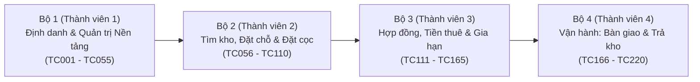

# KẾ HOẠCH THỰC HIỆN & PHÂN CÔNG BÀI TẬP SWT301 (DỄ HIỂU – CHẠY NGAY)

**Dự án áp dụng:** StoreSpace – Hệ thống Quản lý Cho thuê Kho Tự quản (SWP391)  
**Tổng số lượng:** **220 Test Cases** (Yêu cầu tối thiểu: > 200 TC) + **24 Defects (Bugs)**  
**Mốc thời gian:**
* **Nộp bài (Ngày 13/11):** Nộp file Excel Test Case (`SWT301_TestCase_StoreSpace_220TC.xls`) + File Defect List export từ Jira/Trello.
* **Demo trên lớp (Ngày 14/11 – 5 phút):** Giảng viên bốc ngẫu nhiên 1 bộ Module (hoặc 3 Test Cases bất kỳ) yêu cầu chạy trực tiếp trên web.

---

## 1. TẠI SAO CHIA THÀNH 4 BỘ MODULE NHƯ VẬY? (BỨC TRANH TỔNG THỂ)

Toàn bộ dự án StoreSpace được chia thành **4 giai đoạn nối tiếp nhau trong vòng đời thuê kho**. Mỗi thành viên nắm trọn vẹn **1 giai đoạn (55 Test Cases + 6 Bugs)** để không ai bị chồng chéo việc và khi thầy hỏi tới khâu nào thì người đó nắm rõ nhất:

| Bộ / Sheet trong Excel | Người phụ trách | Tên phân hệ chuẩn | Vì sao các việc này đi chung với nhau? |
| :--- | :---: | :--- | :--- |
| **`Module1`** (`TC001`–`TC055`) | **Thành viên 1** | **Định danh, Phân quyền & Quản trị Nền tảng** *(Identity, RBAC & System Admin)* | • Cùng quản lý **Tài khoản & Quyền hạn**: Khách tự đăng ký OTP, Đăng nhập, còn Admin tạo/khóa tài khoản Staff & Manager. • Admin thiết lập **dữ liệu gốc (Master Data)**: Cơ sở, Loại kho, Kích thước, Khung giá, Chính sách để 3 bạn sau có dữ liệu đặt kho. • Gom chung giúp đủ đúng **55 TC** (nếu chỉ làm Đăng ký/Đăng nhập sẽ chỉ được ~25 TC, bị thiếu chỉ tiêu). |
| **`Module2`** (`TC056`–`TC110`) | **Thành viên 2** | **Tìm kiếm Kho, Đặt Giữ Chỗ & Thanh toán Cọc** *(Catalog, Booking & Deposit)* | • Bao trọn hành trình của khách **từ lúc vào web đến lúc đặt cọc xong**: Lọc kho trên Catalog/Sơ đồ → Bỏ vào Giỏ hàng → Đặt giữ chỗ (giữ kho 15 phút) → Thanh toán tiền cọc (VNPay Sandbox / Mô phỏng) hoặc Hủy đơn hoàn cọc. |
| **`Module3`** (`TC111`–`TC165`) | **Thành viên 3** | **Hợp đồng Điện tử, Tiền thuê, Gia hạn & Phí trễ hạn** *(Contract, Rent, Renewal & Late Fee)* | • Bao trọn hành trình **pháp lý & tài chính sau khi đã đặt cọc**: Ký hợp đồng điện tử → Nhận email hợp đồng qua Brevo → Đóng tiền thuê (trả 1 lần hoặc trả hàng tháng) → Gia hạn hợp đồng → Tính phí phạt khi đóng trễ/trả kho trễ. |
| **`Module4`** (`TC166`–`TC220`) | **Thành viên 4** | **Vận hành Cơ sở: Phân công, Bàn giao & Trả kho** *(Facility Operations, Move-In & Move-Out)* | • Bao trọn hành trình **vận hành thực tế tại kho của Manager & Staff**: Manager tạo kho tự sinh mã, bật/tắt bảo trì, phân công việc cho Staff → Staff bàn giao nhận kho (Move-In, cấp mã PIN) → Khách yêu cầu trả kho & Staff kiểm định hư hại / hoàn cọc (Move-Out). |

---

## 2. CHI TIẾT CÔNG VIỆC CỦA TỪNG THÀNH VIÊN (MỖI NGƯỜI 55 TC)

### 👤 Thành viên 1 — Bộ `Module1` (`TC001` đến `TC055`)
* **File chi tiết:** `01_ThanhVien1_Auth_OTP_Admin_55TC.md` (Sheet `Module1` trong file `.xls`)
* **Tài khoản cần dùng khi test/demo:** Khách mới đăng ký + Tài khoản `Business Admin`.
* **3 nhóm chức năng cần nắm vững (55 TC):**
  1. **Đăng ký khách hàng & Mã OTP qua Email (`TC001`–`TC020` — 20 TC):**
     * Đăng ký hợp lệ nhận OTP qua Brevo; kiểm tra biên Họ tên (rỗng, >150 ký tự), Email (sai định dạng, trùng email), Mật khẩu (<6 ký tự, >100 ký tự, xác nhận lệch), SĐT (>30 ký tự).
     * Vòng đời mã OTP: nhập thiếu 6 số, nhập sai 1 lần (còn 4 lần), nhập sai 5 lần (khóa mã), bấm gửi lại trước 60s (chặn cooldown), gửi lại sau 60s (mã cũ hết hiệu lực), mã quá 5 phút hết hạn.
  2. **Đăng nhập & Phân quyền 4 vai trò (`TC021`–`TC035` — 15 TC):**
     * Đăng nhập đúng với 4 vai trò (`Customer`, `Staff`, `Manager`, `Admin`), sai mật khẩu, tài khoản bị khóa (`Inactive`), đăng xuất.
     * Phân quyền bảo mật: dùng tài khoản Customer gõ URL `/admin`, `/manager` hoặc dùng token Staff gọi API Admin (bị chặn 403/401).
  3. **Quản trị Admin (`TC036`–`TC055` — 20 TC):**
     * Tạo tài khoản nhân sự nội bộ (Staff/Manager), khóa/mở khóa tài khoản.
     * Tạo/sửa Cơ sở (kiểm tra trùng mã chi nhánh `TD`, `BT`), Loại kho, Kích thước kho (chặn diện tích/giá $\le 0$), Khung giảm giá theo tháng (`PriceBand`) và 4 Chính sách hệ thống (`Policies`).
* **Lỗi (Defect) phụ trách trên Jira/Trello:** `BUG-001` đến `BUG-006`.

---

### 👤 Thành viên 2 — Bộ `Module2` (`TC056` đến `TC110`)
* **File chi tiết:** `02_ThanhVien2_Catalog_Booking_Payment_55TC.md` (Sheet `Module2` trong file `.xls`)
* **Tài khoản cần dùng khi test/demo:** Khách vãng lai (chưa login) + Tài khoản `Storage Customer`.
* **3 nhóm chức năng cần nắm vững (55 TC):**
  1. **Tra cứu & Lọc kho trên Catalog / Sơ đồ (`TC056`–`TC070` — 15 TC):**
     * Lọc theo Cơ sở, Loại kho, Kích thước, kết hợp nhiều bộ lọc, xóa bộ lọc; kiểm tra kho đang thuê (`Occupied`) hoặc bảo trì (`Maintenance`) không cho đặt; tự động tính giảm giá khi chọn thuê dài hạn ($\ge 6$ tháng).
  2. **Giỏ hàng & Đặt giữ chỗ 15 phút (`TC071`–`TC090` — 20 TC):**
     * Thêm 1 hoặc nhiều kho cùng cơ sở vào giỏ, xóa kho khỏi giỏ, lưu giỏ hàng nháp khi chưa đăng nhập và tự khôi phục sau khi đăng nhập.
     * Tạo đơn giữ chỗ với các tùy chọn: Nhận tại quầy (`Counter`) vs Bàn giao Online (`Online`), Trả 1 lần (`Full`) vs Trả hàng tháng (`Monthly`).
     * Kiểm tra giữ chỗ tự động hết hạn (`Expired`) sau 15 phút và trả kho về `Available`.
  3. **Thanh toán tiền cọc & Hủy đơn hoàn cọc (`TC091`–`TC110` — 20 TC):**
     * Thanh toán tiền cọc bằng Mô phỏng (Simulator) và qua cổng **VNPay Sandbox** (thẻ test NCB `9704198526191432198`, hủy giao dịch mã `24`, chống sửa chữ ký hash, chống F5 trừ tiền 2 lần).
     * Hủy đơn khi chưa đóng cọc, hủy sớm được hoàn 100% cọc, hủy sát ngày nhận kho bị khấu trừ cọc theo chính sách.
* **Lỗi (Defect) phụ trách trên Jira/Trello:** `BUG-007` đến `BUG-012`.

---

### 👤 Thành viên 3 — Bộ `Module3` (`TC111` đến `TC165`)
* **File chi tiết:** `03_ThanhVien3_Contract_Rent_Renewal_LateFee_55TC.md` (Sheet `Module3` trong file `.xls`)
* **Tài khoản cần dùng khi test/demo:** Tài khoản `Storage Customer` (kết hợp công cụ **Demo Clock** trên giao diện).
* **3 nhóm chức năng cần nắm vững (55 TC):**
  1. **Ký Hợp đồng điện tử & Gửi Email qua Brevo (`TC111`–`TC125` — 15 TC):**
     * Xem hợp đồng tự động tạo sau khi đặt cọc; vẽ chữ ký tay lên khung canvas + tích ô đồng ý điều khoản (chặn nếu thiếu 1 trong 2).
     * Tự động gửi bản sao hợp đồng về Gmail qua Brevo ngay sau khi ký hoặc khi bấm nút *"Gửi qua email"*; chặn gửi hợp đồng sang email của người khác.
  2. **Đóng tiền thuê kho định kỳ (`TC126`–`TC140` — 15 TC):**
     * Xem lịch đóng tiền của đơn trả 1 lần (`Full`) vs trả theo tháng (`Monthly`).
     * Chặn đóng tiền khi chưa ký hợp đồng hoặc chưa tới ngày bắt đầu thuê (`StartDate`); dùng **Demo Clock** chỉnh tới ngày nhận kho để đóng kỳ đầu và chỉnh sang tháng kế tiếp để đóng kỳ 2.
  3. **Gia hạn hợp đồng & Phí phạt trễ hạn (`TC141`–`TC165` — 25 TC):**
     * Tạo yêu cầu gia hạn (`GH-...`), tính cọc bổ sung (nếu có), thanh toán gia hạn và ký phụ lục gia hạn.
     * Dùng **Demo Clock** chỉnh ngày quá hạn đóng tiền / quá hạn trả kho: kiểm tra trong thời gian ân hạn (Grace Period) chưa phạt, qua ngày ân hạn tự động phát sinh khoản `LateFee` và thanh toán phí phạt.
* **Lỗi (Defect) phụ trách trên Jira/Trello:** `BUG-013` đến `BUG-018`.

---

### 👤 Thành viên 4 — Bộ `Module4` (`TC166` đến `TC220`)
* **File chi tiết:** `04_ThanhVien4_Manager_Handover_Return_55TC.md` (Sheet `Module4` trong file `.xls`)
* **Tài khoản cần dùng khi test/demo:** Tài khoản `Facility Manager` + `Facility Staff` + `Storage Customer`.
* **3 nhóm chức năng cần nắm vững (55 TC):**
  1. **Manager quản lý kho cơ sở & Phân công Staff (`TC166`–`TC180` — 15 TC):**
     * Xem danh sách kho thuộc cơ sở mình quản lý; tạo kho mới tự động sinh mã theo tiền tố cơ sở (`TD-Uxx`); chuyển kho trống sang Bảo trì (`Maintenance`) và chặn bảo trì kho đang có khách thuê (`Occupied`).
     * Phân công Staff phụ trách đơn Nhận kho (`Move-In`) hoặc Trả kho (`Move-Out`), tự động gửi email báo việc cho Staff qua Brevo; xem báo cáo doanh thu thực thu theo 5 loại phí.
  2. **Staff Bàn giao nhận kho — Move-In (`TC181`–`TC200` — 20 TC):**
     * Kiểm tra điều kiện chặn bàn giao: khách chưa ký hợp đồng, chưa đóng tiền kỳ đầu, hoặc chưa tới ngày bắt đầu thuê.
     * Hoàn tất bàn giao tại quầy (`Counter`) và bàn giao online (`Online` — tự động gửi email báo khách nhận chìa tại lễ tân); cấp mã PIN ra vào kho cho khách.
  3. **Khách yêu cầu Trả kho & Staff Kiểm định hoàn cọc — Move-Out (`TC201`–`TC220` — 20 TC):**
     * Khách gửi yêu cầu trả kho; Staff thực hiện kiểm định với 3 trường hợp: **Không hư hại** (hoàn 100% cọc), **Hư hại nhẹ** (khấu trừ phí bồi thường vào cọc rồi hoàn phần dư), **Hư hại vượt tiền cọc** (giữ hết cọc và ghi nợ thêm).
     * Kho tự động chuyển về `Available` trên Catalog ngay sau khi hoàn tất trả kho.
* **Lỗi (Defect) phụ trách trên Jira/Trello:** `BUG-019` đến `BUG-024`.

---

## 3. CÁC BƯỚC LÀM NGAY ĐỂ KỊP NỘP NGÀY 13/11 & DEMO NGÀY 14/11

### Bước 1: Hoàn thiện file Excel Test Case (15 phút)
1. Mở file **`SWT_test/SWT301_TestCase_StoreSpace_220TC.xls`** bằng Microsoft Excel.
2. Điền tên thật của 4 thành viên vào:
   * Sheet `Cover` (ô `G4` - Creator) và Sheet `Test Report` (ô `H3`).
   * Ô `B4` (`Tester`) tại 4 sheet `Module1`, `Module2`, `Module3`, `Module4`.
3. Mỗi thành viên đọc lướt qua 55 Test Cases trong sheet của mình và bấm thử trên web để nắm chắc thao tác trên màn hình.

### Bước 2: Đưa Defect List lên Jira / Trello và Export (15 phút)
1. Tạo 1 Project trên **Jira** (hoặc 1 Board trên **Trello**).
2. Dùng file **`SWT_test/SWT301_Defect_List_Jira_Trello.csv`** (hoặc nội dung trong `05_Defect_List_Jira_Trello.md`) để Import / tạo 24 thẻ Bug (`BUG-001` đến `BUG-024`, mỗi người 6 lỗi).
3. Bấm **Export (CSV / Excel)** từ Jira hoặc Trello ra file để nộp kèm với file `SWT301_TestCase_StoreSpace_220TC.xls`.

### Bước 3: Chuẩn bị trước khi lên Demo 5 phút (Ngày 14/11)
* Mở sẵn 3 cửa sổ trình duyệt:
  1. **Cửa sổ 1:** Đăng nhập sẵn `Customer`.
  2. **Cửa sổ 2 (Ẩn danh):** Đăng nhập sẵn `Facility Manager` / `Staff` / `Admin`.
  3. **Cửa sổ 3:** Mở sẵn Gmail nhận thư (để show OTP/Hợp đồng) + Bảng Jira/Trello + File Excel.
* Khi giảng viên chỉ định ngẫu nhiên 1 trong 4 sheet `Module1`..`Module4` (hoặc 3 Test Cases bất kỳ), thành viên phụ trách sheet đó lên thao tác theo đúng cột `Test Case Procedure`:
  * Nếu là **case phụ thuộc ngày tháng** (tới ngày nhận kho, đóng tiền kỳ 2, quá hạn phạt Late Fee): bấm **Demo Clock** chỉnh ngày giả lập đúng với cột `Inter-test case Dependence` rồi thực hiện.
