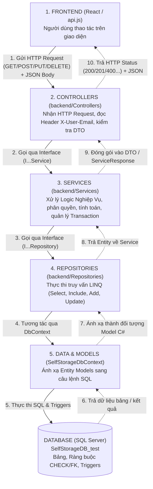

# Kiến Trúc Hệ Thống & Luồng Đi Dữ Liệu (`luong_du_lieu.md`)

Tài liệu này giải thích chi tiết cấu trúc dự án **Self-Storage**, cách tổ chức kiến trúc phân tầng (**3-Layer Architecture + Repository Pattern**) ở Backend, và cách dữ liệu luân chuyển khép kín từ **Frontend (React/Vite)** $\leftrightarrow$ **Backend (.NET 10)** $\leftrightarrow$ **Database (SQL Server - `SelfStorageDB_test`)**.

---

## 1. Tổng Quan Cấu Trúc Thư Mục Dự Án

```text
Self-Storage/
├── frontend/                   # Giao diện người dùng (React + Vite)
│   └── src/
│       ├── api.js              # Hàm trung tâm gửi/nhận HTTP Request tới Backend
│       ├── operationsState.js  # Đồng bộ dữ liệu trạng thái vận hành
│       ├── App.jsx             # Trang chủ, tìm kiếm kho, Đăng nhập / Đăng ký
│       ├── CustomerAccount.jsx # Cổng thông tin Khách hàng thuê kho
│       ├── FacilityStaffAccount.jsx   # Cổng làm việc Nhân viên cơ sở
│       ├── FacilityManagerAccount.jsx # Cổng quản lý của Quản lý cơ sở
│       ├── BusinessOperations.jsx     # Cổng điều hành của Quản lý vận hành tổng (BOM)
│       └── AdminAccount.jsx    # Cổng quản trị tài khoản của System Admin
│
├── backend/                    # Xử lý nghiệp vụ & API (ASP.NET Core .NET 10)
│   ├── Controllers/            # Tầng 1: Tiếp nhận HTTP Request & trả về HTTP Response
│   ├── Services/               # Tầng 2: Xử lý toàn bộ logic nghiệp vụ (Business Logic)
│   ├── Repositories/           # Tầng 3: Truy vấn cơ sở dữ liệu bằng LINQ / EF Core
│   ├── Interfaces/             # Khai báo các Interface cho Services & Repositories (DI)
│   ├── DTOs/                   # Khuôn mẫu dữ liệu giao tiếp giữa Frontend & Backend
│   ├── Models/                 # Các class C# ánh xạ 1-1 với 26 bảng trong Database
│   ├── Data/                   # SelfStorageDbContext (Cấu hình EF Core, quan hệ, Triggers)
│   ├── Constants/              # Hằng số trạng thái (ReservationStatus, UnitStatus, RoleNames)
│   ├── Program.cs              # Khởi tạo ứng dụng, cấu hình CORS, DbContext, Dependency Injection
│   └── appsettings.json        # Chuỗi kết nối Database (Connection String)
│
├── database/
│   └── SelfStorageDB_test.sql  # Script khởi tạo 26 bảng, Views, Functions, Triggers & Seed Data
│
├── API_DOCUMENTATION.md        # Tài liệu chi tiết 36 API Endpoints
└── luong_du_lieu.md            # Tài liệu kiến trúc & luồng dữ liệu (file hiện tại)
```

---

## 2. Sơ Đồ Luồng Đi Của Dữ Liệu (End-to-End Data Flow)

Mọi thao tác của người dùng trên giao diện (ví dụ: Đăng nhập, Đặt kho, Thanh toán tiền cọc, Duyệt đơn, Bàn giao kho...) đều đi theo một vòng khép kín qua **5 chặng**:



---

## 3. Chi Tiết Trách Nhiệm Của Từng Tầng

### Chặng 1: Frontend gửi API (`frontend/src/api.js`)
- Khi người dùng bấm nút trên màn hình (VD: bấm *"Xác nhận đặt kho"* hoặc *"Thanh toán cọc"*), Component React sẽ gọi các hàm `apiGet()`, `apiPost()`, `apiPut()`, `apiDelete()` trong [`frontend/src/api.js`](./frontend/src/api.js).
- Hàm `apiRequest()` tự động:
  1. Ghép đường dẫn với `http://localhost:5046`.
  2. Đặt header `Content-Type: application/json`.
  3. Lấy email người dùng đang đăng nhập từ `localStorage` và gắn vào header `X-User-Email`.
  4. Chuyển dữ liệu JavaScript thành chuỗi JSON và gửi đi.

### Chặng 2: Backend tiếp nhận tại Tầng `Controllers/`
- Các file trong [`backend/Controllers/`](./backend/Controllers/) đóng vai trò như "người lễ tân":
  - **Không** chứa code tính toán nghiệp vụ phức tạp.
  - **Không** viết câu lệnh truy vấn SQL trực tiếp.
  - Chỉ làm 3 việc:
    1. Nhận dữ liệu đầu vào (`[FromBody] DTO`, `[FromRoute]`, `[FromQuery]`) và đọc `Request.Headers["X-User-Email"]`.
    2. Chuyển yêu cầu sang tầng `Service` tương ứng.
    3. Dựa vào kết quả `Service` trả về để quyết định mã trạng thái HTTP (`200 OK`, `201 Created`, `204 NoContent`, `400 BadRequest`, `401 Unauthorized`, `403 Forbidden`, `404 NotFound`, `409 Conflict`).

### Chặng 3: Xử lý nghiệp vụ tại Tầng `Services/`
- Các file trong [`backend/Services/`](./backend/Services/) là "bộ não" của hệ thống:
  - Kiểm tra quyền hạn người dùng (VD: Chỉ `Business Operations Manager` mới được đổi bảng giá hoặc tạo cơ sở mới; chỉ `Facility Manager` của cơ sở đó mới được duyệt đơn tại cơ sở đó).
  - Thực hiện các quy tắc nghiệp vụ:
    - Trong [`AuthService.cs`](./backend/Services/AuthService.cs): Băm mật khẩu bằng `BCrypt.Net` khi đăng ký và kiểm tra mật khẩu bằng `BCrypt.Verify` khi đăng nhập.
    - Trong [`ReservationService.cs`](./backend/Services/ReservationService.cs): Giải phóng các đơn giữ chỗ đã quá hạn 15 phút (`ReleaseExpiredAsync`), kiểm tra kho có trống trong kỳ thuê hay không, tính tiền thuê tháng sau chiết khấu, tính tiền cọc (`DepositMonths`), tạo mã đơn (`ReservationCode`), tạo dòng giữ kho (`ReservationUnit`) và khoản phải thu (`Charge`).
    - Trong [`PaymentService.cs`](./backend/Services/PaymentService.cs): Tạo giao dịch `Payment`, cập nhật khoản cọc `Charge` sang `"Paid"`, và chuyển trạng thái `Reservation` sang `"Paid"`.
    - Trong [`HandoverService.cs`](./backend/Services/HandoverService.cs): Tự động sinh Hợp đồng (`Contract`), tạo nhiệm vụ bàn giao (`HandoverTask`), cấp quyền truy cập (`UnitAccess`), chuyển trạng thái kho sang `"In Use"` và đơn đặt sang `"Handed Over"`.

### Chặng 4: Truy vấn dữ liệu tại Tầng `Repositories/`
- Các file trong [`backend/Repositories/`](./backend/Repositories/) chuyên trách giao tiếp với cơ sở dữ liệu:
  - Viết các câu truy vấn LINQ (`_context.Reservations.Include(...).Where(...).FirstOrDefaultAsync(...)`).
  - Quản lý Transaction (`BeginTransactionAsync(IsolationLevel.Serializable)`) để đảm bảo tính toàn vẹn dữ liệu khi ghi nhiều bảng cùng lúc.
  - Giúp cô lập hoàn toàn câu lệnh truy vấn DB khỏi tầng `Services` và `Controllers`.

### Chặng 5: Ánh xạ & Ràng buộc tại `Data/`, `Models/` và SQL Server (`SelfStorageDB_test`)
- **[`SelfStorageDbContext.cs`](./backend/Data/SelfStorageDbContext.cs)**:
  - Quản lý 26 `DbSet<T>` tương ứng với 26 bảng trong `SelfStorageDB_test`.
  - Khai báo đầy đủ khóa chính, khóa ngoại, cột tính toán tự động (`AreaM2`, `VolumeM3`, `EffectiveMonthlyPrice`), và khai báo `.HasTrigger(...)` cho các bảng có SQL Trigger.
- **Database (`SelfStorageDB_test`)**:
  - Chốt chặn bảo vệ dữ liệu cuối cùng bằng các `CHECK Constraint`, `UNIQUE Filtered Index` và hệ thống `AFTER INSERT, UPDATE Triggers` (tự động kiểm tra chuyển trạng thái hợp lệ và tự động ghi nhật ký thay đổi vào bảng `StatusChangeLog`).

---

## 4. Ví Dụ Thực Tế: Luồng "Khách Hàng Đặt Chỗ Thuê Kho"

Để dễ hình dung nhất, dưới đây là hành trình của 1 cú click chuột **"Xác nhận đặt kho"** từ đầu đến cuối:

1. **Frontend**:
   - Khách hàng chọn kho `TD-U03`, ngày bắt đầu `2026-11-01`, thời hạn `3 tháng` rồi bấm đặt kho.
   - Frontend gọi:
     ```javascript
     apiPost('/api/Reservation', {
       unitID: 3,
       unitNumber: 'TD-U03',
       startDate: '2026-11-01T00:00:00',
       months: 3
     })
     ```
2. **Controller ([`ReservationController.cs`](./backend/Controllers/ReservationController.cs))**:
   - Hàm `CreateReservation` nhận `CreateReservationDTO` và đọc `email` từ header `X-User-Email`.
   - Gọi `_reservationService.CreateReservationAsync(request, email, cancellationToken)`.
3. **Service ([`ReservationService.cs`](./backend/Services/ReservationService.cs))**:
   - Gọi `_holdService.ReleaseExpiredAsync()` để nhả các đơn giữ chỗ quá hạn 15 phút.
   - Kiểm tra `months` có thuộc `{1, 3, 6, 12}` hay không.
   - Mở một **Serializable Transaction** thông qua `_reservationRepository.ExecuteInSerializableTransactionAsync(...)`.
   - Kiểm tra kho `TD-U03` có đang hoạt động và còn trống trong khoảng `01/11/2026 -> 31/01/2027` không.
   - Lấy giá thuê từ `RentalRate` và chính sách số tháng cọc từ `RentalPolicy`.
   - Tạo lần lượt các bản ghi: `Reservation` (trạng thái `"Pending Payment"`, giữ chỗ 15 phút) $\rightarrow$ `ReservationItem` $\rightarrow$ `ReservationUnit` (trạng thái `"Held"`) $\rightarrow$ `Charge` (khoản tiền cọc trạng thái `"Unpaid"`).
4. **Repository ([`ReservationRepository.cs`](./backend/Repositories/ReservationRepository.cs)) & Database**:
   - Lưu xuống SQL Server qua `_context.SaveChangesAsync()`.
   - Trigger `TR_Reservation_Validate`, `TR_ReservationUnit_BlockOverlap` và `TR_Reservation_LogStatus` trong SQL Server chạy kiểm tra không trùng lịch thuê và ghi log trạng thái.
5. **Trả kết quả về Frontend**:
   - `Service` đóng gói thông tin đơn đặt (mã đơn, số tiền cọc, thời điểm hết hạn giữ chỗ `expiresAt`) trả về `Controller`.
   - `Controller` trả HTTP `201 Created` kèm JSON về cho Frontend.
   - Frontend nhận JSON và chuyển khách hàng sang màn hình đếm ngược thanh toán tiền cọc.

---

## 5. Các Điểm Mạnh Trong Thiết Kế Của Dự Án

1. **Đúng chuẩn Kiến trúc 3 Lớp (3-Tier Architecture)**:
   - Tách bạch hoàn toàn giữa **Giao tiếp HTTP (`Controllers`)** – **Nghiệp vụ (`Services`)** – **Truy xuất dữ liệu (`Repositories`)**.
   - Khi thay đổi cấu trúc Database (như việc chuyển sang `SelfStorageDB_test`), chỉ cần cập nhật ở tầng `Models`/`Repositories`/`Services` mà **không làm gãy API hay giao diện Frontend**.
2. **Bảo mật dữ liệu qua `DTOs` (Data Transfer Objects)**:
   - Không bao giờ trả trực tiếp các Entity nhạy cảm (như `User` chứa `PasswordHash`) ra ngoài API. Mọi dữ liệu vào/ra đều được lọc qua các lớp DTO trong [`backend/DTOs/`](./backend/DTOs/).
3. **Áp dụng Dependency Injection (DI) qua `Interfaces`**:
   - Toàn bộ `Services` và `Repositories` giao tiếp với nhau thông qua Interface (`IReservationService`, `IReservationRepository`...) được đăng ký tập trung tại [`Program.cs`](./backend/Program.cs).
4. **Chống xung đột dữ liệu (Concurrency & Transaction Safety)**:
   - Các luồng nhạy cảm (Đặt kho, Thanh toán, Bàn giao, Ký hợp đồng) đều sử dụng Database Transaction mức `Serializable`, kết hợp với Trigger ở tầng SQL Server, đảm bảo không bao giờ xảy ra tình trạng 2 khách hàng đặt trùng 1 kho cùng lúc hoặc tiền đã trừ mà đơn không cập nhật.

